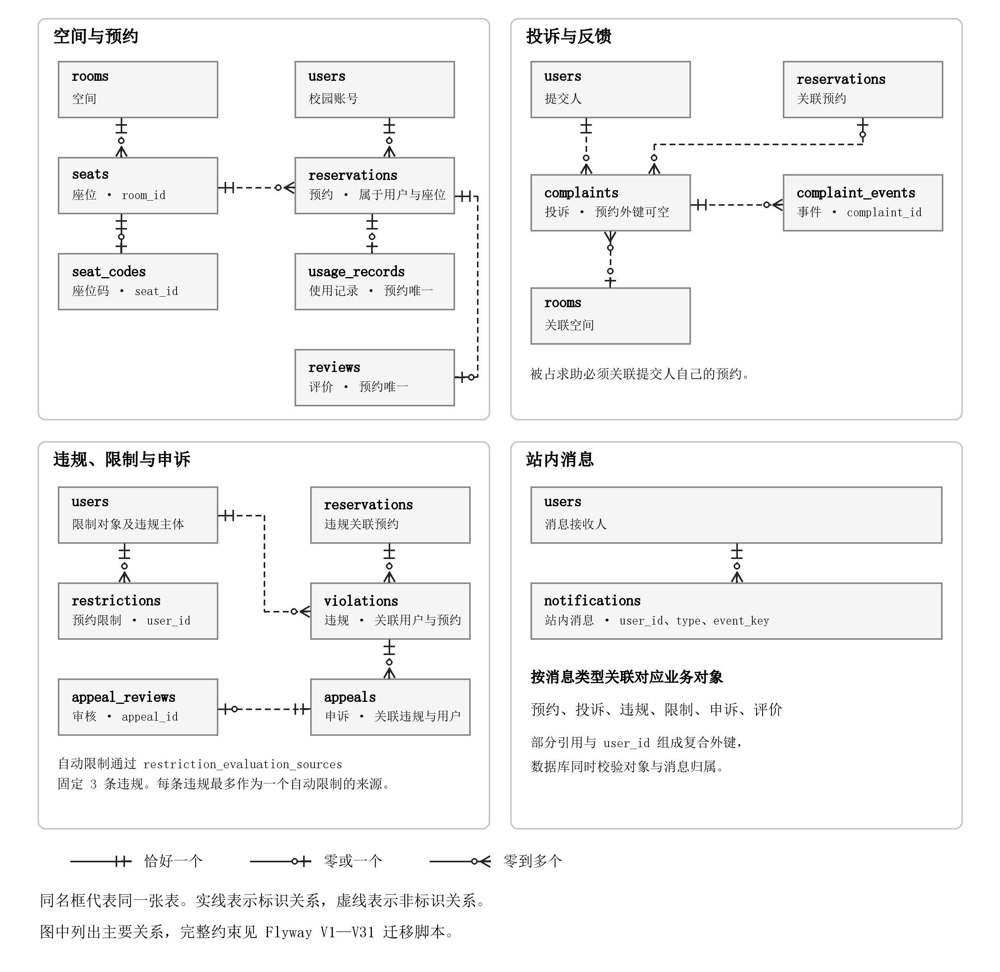
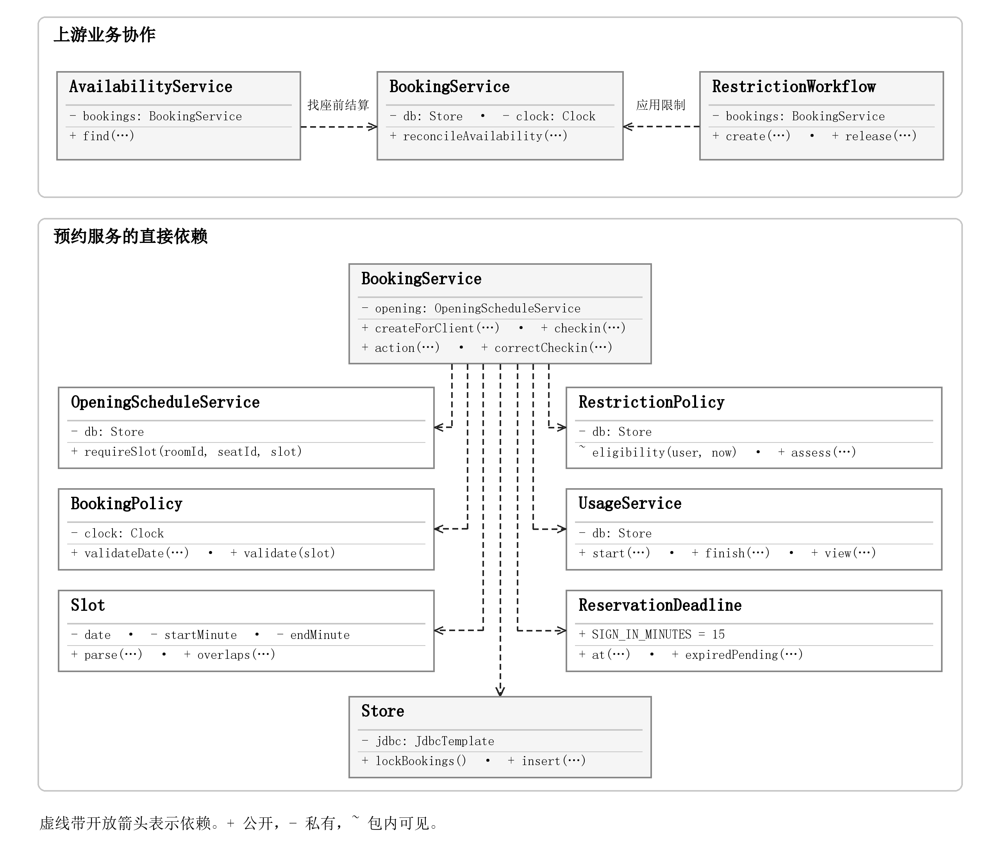
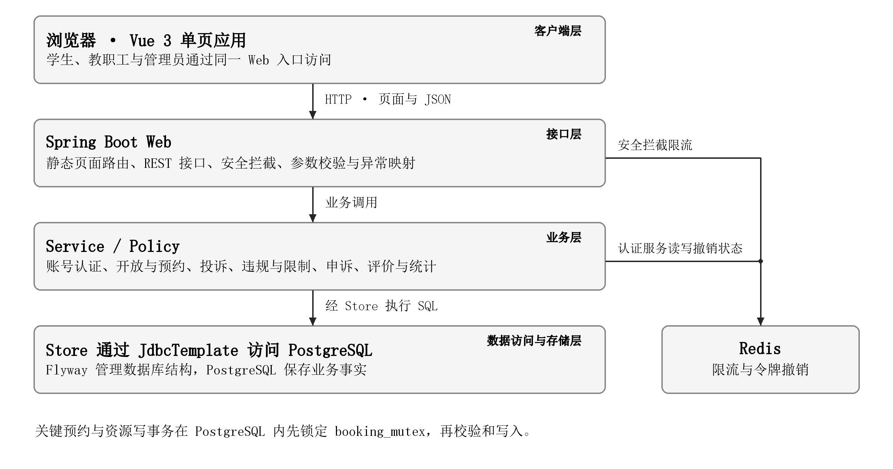
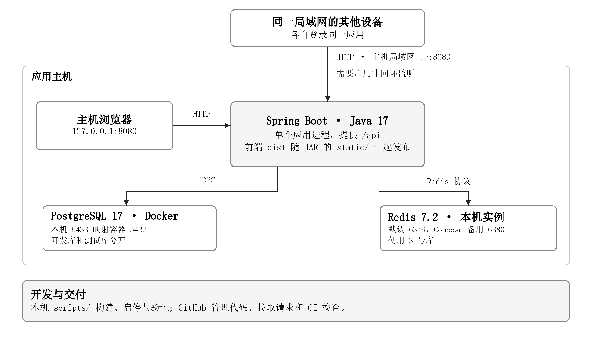
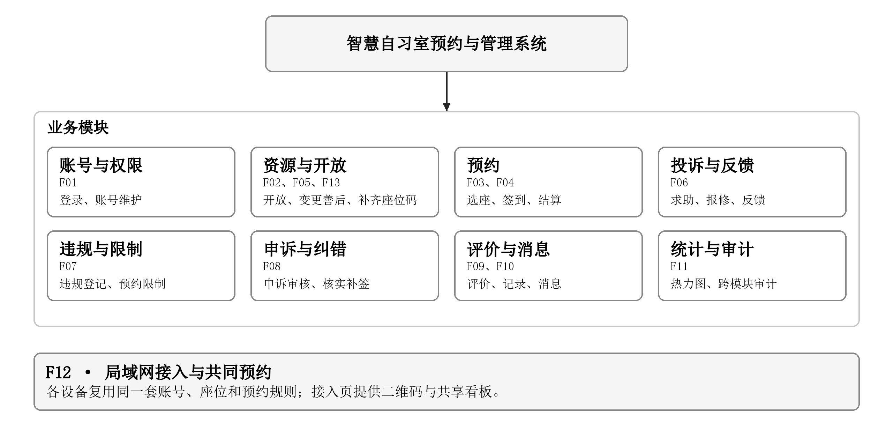
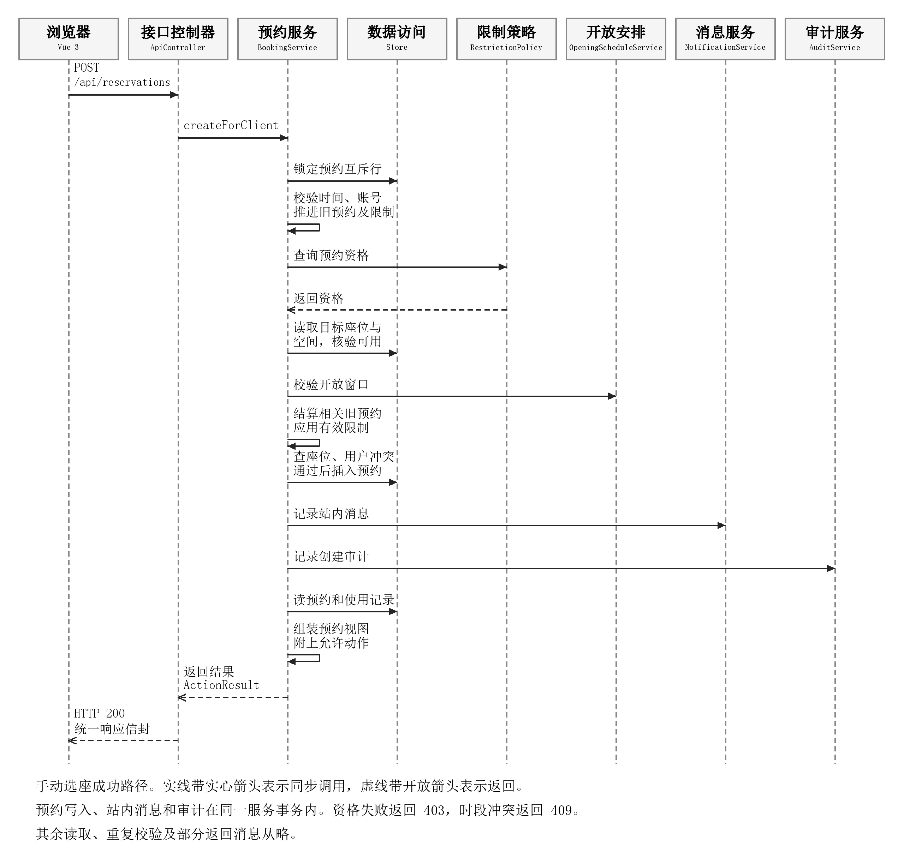
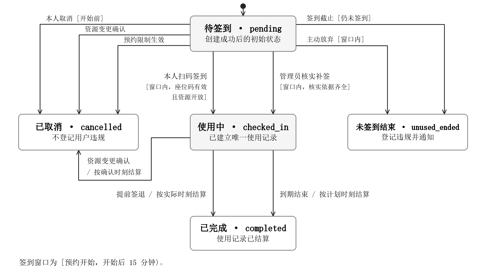

# 智慧自习室预约与管理系统 系统设计报告

| 项目名称 | 智慧自习室预约与管理系统（Smart Study Room Reservation and Management System） |
|---|---|
| 文档类型 | 系统设计说明 |
| 需求依据 | [需求规格说明书](../requirements/01_需求规格说明书.md) v0.29（F13 基线，2026-11-26 修订）及 v0.31 §8.39（信誉分与预约限制） |
| 对应实现 | `backend/`（Java 17 / Spring Boot 2.7.18）、`frontend/`（Vue 3 单页应用）、PostgreSQL 17、Redis 7.2；本文对应 `main` 提交 `6ce368e`（2026-11-26），首个发布基线为 `v1.0.0-postgresql` |
| 文档版本 | V1.1 |
| 编制日期 | 2026-11-26 |

## 0 文档说明

### 0.1 文档目的与内容

本报告是智慧自习室预约与管理系统（以下简称"本系统"）的设计说明，用于说明当前实现的设计、接口与业务约束，供后续维护、测试与验收使用。报告按照软件设计的四个层次组织：**数据设计（类设计）**——软件的全局数据结构设计，包括数据实体及其属性和相互之间的关系；**体系结构设计**——决定系统的高层分解结构以及各种全局性的设计决策（如开发语言、异常处理策略）；**接口设计**——组件之间的交互接口设计，包括接口的功能和非功能性（如性能、吞吐量）要求、接口交互协议、接口操作及实现类定义等；**构件（组件）级设计**——组件内的具体设计方案，如类及类之间关系、组件内部局部数据结构和算法设计等。

报告正文以图配文的方式说明上述设计，文中所有图件均为依据本系统实际代码与数据库结构绘制的真实设计图，可编辑源文件见 `docs/design/src/`。

### 0.2 术语与缩略语

为使术语严谨且便于理解，先给出本文档使用的术语与缩略语。

| 术语/缩略语 | 含义 |
|---|---|
| 软件配置项 | 满足最终使用功能的软件集合，本文档中即指本系统整体 |
| 设计类 | 构件级设计中承担单一职责、可独立演化的类或接口单元 |
| 契约 | 方法调用之前和之后应当满足的条件（前置条件、后置条件与状态不变量），本系统以校验语句、数据库约束与触发器表达 |
| 投影（Projection） | 只读的视图数据对象，把内部数据裁剪为某一角色或场景可见的安全子集 |
| 互斥锁 | 写事务先对互斥表固定行执行行级锁定，使并发写事务串行化 |
| 幂等操作 | 以操作标识加请求哈希标识的写操作，重复提交返回已保存结果而不重复生效 |
| 事件溯源 | 业务状态变化以追加事件的方式记录，事件一旦写入不可覆盖 |
| 预约时间窗口 D—D+2 | 可预约的校园自然日范围，即当天及之后两天 |
| p95 | 第 95 百分位响应时间 |

---

## 1 系统概述

### 1.1 系统目标与意义

自习空间是高校里最紧张的资源之一，实际使用中存在三类典型问题：满座时难以判断哪里还能约、座位图信息密集难以快速看清可约状态、预约权益与现场就座之间缺少衔接。本系统围绕这三类问题设计，把「找座 → 预约 → 扫码签到 → 使用结算 → 异常求助 → 核实处置 → 违规与申诉 → 记录与统计」串成一个可追踪的闭环，实现以下目标：

1. **找得到**：按开始时间和学习时长筛选从所选时刻起连续可用的座位，并可在满足时间的座位中优先查看靠窗或插座座位；平面图、逐段列表与 3D 视图读取同一份计算结果。
2. **看得懂**：座位编号、位置与可约时段在图上和列表中都可见，状态不依赖颜色单一表达。
3. **管得住**：预约、签到、使用记录、资源变更、投诉、违规、限制与申诉各有明确状态与失败反馈；关键动作与操作理由留痕，越权与冲突在服务端拒绝。

### 1.2 系统范围与角色

本系统的使用者划分为三类角色：**学生**与**教职工**（可预约与使用座位，可投诉、申诉、评价、查看本人记录与消息），**管理员**（维护资源与账号，核实投诉、登记违规、创建与解除限制、审核申诉、管理评价、查看审计与统计）。系统只提供"手动选座预约"一种预约方式，旧自动分配与新增候补已退出，历史候补记录保留可查。

系统业务范围覆盖 F01—F13，包括校园账号与权限、资源与开放安排、预约生命周期、预约选座、资源变更善后、投诉核实反馈、违规累计限制、申诉与签到纠错、使用评价、记录与消息查询、统计与整体验收、局域网接入与共同预约、批量生成座位二维码。功能编号与部署中的模块归属见第 8 章。

### 1.3 运行环境与技术选型

| 层次 | 选型 | 说明 |
|---|---|---|
| 后端 | Java 17、Spring Boot 2.7.18、Spring JDBC、Spring Data Redis、Bean Validation | REST 接口、业务规则与数据访问；`Store` 是唯一 SQL 入口 |
| 前端 | Vue 3.5、Vue Router 5、Pinia 4、Axios、ECharts 6、Three.js | 单页应用、角色路由守卫、2D/3D 座位图与统计图表；构建产物装入 JAR 的 `static/` |
| 数据库 | PostgreSQL 17（Flyway V1—V31 增量迁移） | 开发库 `studyroom_java` 与测试库 `studyroom_java_test` 分离 |
| 缓存与限流 | Redis 7.2（3 号库，键前缀 `studyroom-java:`） | 登录/预约限流、注销令牌撤销 |
| 认证 | `com.auth0:java-jwt`（HMAC256，7 天）、BCrypt | 令牌签发与校验、口令哈希 |
| 二维码 | ZXing（后端生成 PNG）、`@zxing/browser`（前端解码） | 每座位当前码，用于签到核验 |
| 时区 | `Asia/Shanghai` | 全系统统一校园时区 |

---

## 2 设计原则与设计思想

### 2.1 设计原则

本系统在设计上遵循以下原则：

1. **实用性**。系统主要为了公平合理地分配自习室座位资源，提高自习室精细化管理能力。在设计时，充分认识自习室管理的现状与存在的问题，在保证必要功能齐全的情况下，精简系统结构，使系统实用、不累赘。
2. **安全可靠性**。系统后台存有大量学生信息，最大限度地保证信息不泄露、不丢失是系统必须考虑的。口令采用 BCrypt 哈希存储，接口统一校验令牌与权限，上传文件受控校验，关键操作全部审计留痕。
3. **强健性**。系统各模块具有"低耦合、高内聚"的特点：每个服务只承担一个业务域的职责，业务规则集中实现一次，查询与提交共用同一套判定，便于系统的移植、部署与测试。
4. **易用性**。在满足功能需求的前提下，优化页面设计，合理安排页面布局与操作流程，状态与失败反馈明确，方便学生、教职工与管理员的使用。
5. **效率性**。为了更好服务用户，应提高系统响应速度，减少用户等待时间。系统在单机教学规模下响应目标为 2 秒内，核心查询均有索引覆盖。

### 2.2 设计思想

本系统的设计遵循以下软件设计思想：

1. **分解与抽象**。系统按"表现层—接口层—业务层—数据访问层"逐层分解；业务规则集中到少数权威类中，调用方只面对方法抽象，不接触 SQL 与内部数据结构。
2. **软件体系结构**。顶层采用单进程 Spring Boot 加前端单页应用加 PostgreSQL 与 Redis 的结构，全局约定（时区、异常映射、事务策略、审计）统一声明。
3. **关注点分离**。横向按业务域分离（预约、资源、投诉、违规、申诉、评价、统计分属不同服务类），纵向按技术层次分离（控制器只做参数收转、服务承载业务规则、数据访问类独占 SQL），横切关注点（认证、权限、限流、审计）集中处理。
4. **模块化**。以类为基本模块，用内聚与耦合衡量独立性；公共判断（时间区间、签到截止、分页组装、请求对象）被多个模块共享，避免重复实现。
5. **信息隐藏**。属性一律私有，数据访问类对调用方隐藏 SQL 与行映射细节，只读投影对管理私有字段做白名单裁剪，私有信息不进入公开数据对象。
6. **重构**。历史功能按设计退化后原位收敛（旧自动分配、候补递补、临时离开返回 410 并保留历史记录），使用记录迁移为唯一权威来源。
7. **复用**。复用 Spring Boot 框架能力（拦截器、事务、校验、调度），公共工具类多域复用，二维码生成与解码能力复用。

---

## 3 数据设计

数据设计是软件的全局数据结构设计，包括数据实体及其属性和相互之间的关系。本章说明本系统的核心数据实体、实体之间的关系、数据约束以及数据访问方式。

### 3.1 核心数据实体及其属性

本系统数据以 PostgreSQL 表为持久化事实来源，结构由 Flyway V1—V32 增量迁移维护。核心数据实体如下（完整字段以迁移脚本为准）：

| 实体（表） | 主要属性 | 说明 |
|---|---|---|
| 用户 users | id、username、campus_id、password_hash、real_name、role、status、phone、email | 学生/教职工/管理员；校园编号唯一；口令哈希存储 |
| 空间 rooms | id、name、building、floor、location、seat_rows、seat_cols、enabled、version | 自习空间；版本号供乐观校验 |
| 座位 seats | id、room_id、seat_no、row_no、col_no、zone、has_power、near_window、status、version | 分区、电源、靠窗与状态；状态含可用/维护/停用 |
| 预约 reservations | id、user_id、seat_id、res_date、start_time、end_time、status、source、ended_at、termination_reason | 状态含待签到/使用中/已完成/已取消/未签到结束 |
| 使用记录 usage_records | reservation_id（唯一）、checkin_at、ended_at、end_reason、settled_at、origin | 真实使用事实的唯一来源 |
| 开放安排 opening_schedules / opening_windows | room_id、weekday 或 schedule_date、reason；start_minute、end_minute | 星期分段或日期例外的开放窗口 |
| 临时停用 resource_unavailability | room_id、seat_id、start_at、end_at、reason、cancelled | 整空间或单座停用，软删除 |
| 违规 violations | id、user_id、reservation_id、type、occurred_at、registered_at、status、source | 类型含未签到、开始后未签到主动放弃及核实占座后拒不配合。状态含有效与撤销 |
| 信誉分轮次、成员与变动 | credit_rounds、credit_round_violations、credit_round_events | 记录轮次期限、纳入计分的违规、扣分与恢复依据 |
| 预约限制 restrictions | id、user_id、source、starts_at、ends_at、reason、released_at、version | 来源含手动/自动/历史接管 |
| 新规则限制评估、审核重算 | credit_restriction_evaluations、credit_restriction_recalculations | 记录自动限制触发的两个来源和审核时原轮信誉分及限制的处理依据 |
| 投诉 complaints | id、user_id、type、status、description、reservation_id、room_id、service_kind、fault_type、initial_priority、auto_rule_version | 状态含待受理/处理中/待确认/已结案/已撤回，设施报修保存自动级别和规则版本 |
| 投诉事件 complaint_events | complaint_id、event_type、source、operation_id、request_hash、outcome、public_note | 事件溯源，不可覆盖 |
| 申诉 appeals | id、user_id、violation_id、deadline、status、version | 违规通知后 7 天内提交 |
| 审核 appeal_reviews | appeal_id、decision、reason、verification_note、facts_confirmed、booking_effects | 同意时撤销原违规并按原批次重算 |
| 评价 reviews | reservation_id（唯一）、rating、content、admin_reply、hidden | 每预约一条评价 |
| 座位码 seat_codes | seat_id（主键）、code_value、enabled、version、created_at、updated_at | 每座至多一个当前码。首次生成与批量补齐共用此表，PNG 按需生成 |
| 消息 notifications | user_id、type、title、content、is_read、event_key、各业务外键 | 按类型关联业务对象 |
| 审计 audit_events | actor_id、action、object_type、object_id、reason、before_values、after_values | 关键动作前后快照 |

### 3.2 数据实体之间的关系

图 1 展示引入信誉分轮次前的核心实体关系。当前违规与限制的关系见 DM-01。

- 一个用户可发起多条预约，可接收多条消息，可产生多条违规、投诉、申诉与评价记录，也可被施加多条预约限制。每条预约至多有一条使用记录，成功签到或核实补签后生成。
- 一个空间包含多个座位；一个空间配置星期开放窗口与日期例外；一个空间或单个座位可有多次临时停用。
- 一个座位可被多次预约。被占求助必须关联提交人本人的预约，其他投诉可不关联预约。同一预约可被多条投诉引用。
- 一条投诉追加多条事件（事件溯源），配置受理与首次反馈处理目标，可绑定最多三张受控图片材料。
- 一条违规可关联多次申诉，同一时刻至多有一条待审核申诉。审核同意时按该违规所属信誉分轮次或旧批次的原规则重算。
- 一个用户可有多个历史信誉分轮次，新计分的有效违规关联其轮次，新自动限制关联触发轮次。关系见 [DM-01](../requirements/图模型/模型源与图件.md#dm-01-核心领域类图)。
- 一个座位至多有一个当前座位码。一条消息按类型关联相应的预约、投诉、违规、限制、申诉或评价。

图 1　核心数据实体关系图

### 3.3 数据约束与不变量

为保证数据的一致性与业务规则的正确执行，本系统在数据库层与服务层共同施加以下约束（数据契约）：

1. 预约时间区间必须同日且结束晚于开始；单次预约至少 30 分钟、整分钟；`24:00` 仅可作结束。
2. 使用记录结束时间不得早于签到时间；结束时间、结束原因与结算时间要么同时为空、要么同时齐全；结算时由 `UsageService` 一次写齐这三个字段。管理员补签所记录的核实事实受 V20 触发器保护。
3. 投诉处于待受理时无处理人，进入处理中及之后必须有处理人与受理时间；正式反馈后进入 7 天确认期，逾期自动结案，且不表示投诉人已确认处理结果。
4. 受理处理目标为提交时刻加 15 分钟，首次正式反馈目标为提交时刻加 24 小时（或按开放日历推导），目标时间由数据库约束固化。
5. 新登记的有效违规纳入 V32 轮次，同一违规只纳入一次。新自动限制在首条生效后未满 360 小时时由第二条触发，期限为第二条登记后 360 小时。旧自动限制的三条来源、原约束和截止按旧批次保留。
6. 申诉提交须在违规通知后 168 小时（7 天）内，截止时间由数据库约束固化。审核同意时撤销原违规，并按原轮或原批次规则重算。

### 3.4 全局数据结构

本系统运行时使用的全局常量如下表所示，它们集中定义在各纯判断类与策略类中，供业务层统一引用：

| 常量 | 值 | 位置 |
|---|---|---|
| 校园时区 CAMPUS_ZONE | Asia/Shanghai | 预约规则类 |
| 最大提前预约天数 MAX_ADVANCE_DAYS | 2 | 预约规则类 |
| 单次最短时长 MIN_DURATION_MINUTES | 30 | 时间区间类 |
| 签到窗口 SIGN_IN_MINUTES | 15 | 签到截止类 |
| 信誉满分 / 单次扣分 / 分数下限 | 100 / 10 / 0 | 信誉分服务、迁移 V32 |
| 新自动限制窗口 / 阈值 / 时长 | 360 小时 / 2 条 / 360 小时 | 信誉分服务、迁移 V32 |
| 历史自动限制窗口 / 阈值 / 时长 | 720 小时 / 3 条 / 168 小时 | 旧批次评估与申诉重算、迁移 V17 |
| 投诉受理 / 首次反馈目标 | 提交+15 分钟 / 提交+24 小时 | 处理目标表 |
| 反馈确认期 / 申诉期限 | 7 天 / 通知后 168 小时 | 投诉工作流、申诉表 |
| 上传限制 | 单文件 6MB / 单请求 7MB | 配置文件 |
| 限流 | 登录 10 次/60 秒/地址；预约写 2 次/秒/用户 | 安全拦截器 |

除上述常量外，全局数据以第 3.1 节的数据表为持久化事实来源；运行时全局对象仅限框架容器管理的单例服务与注入的时钟对象。通用数据结构包括：时间区间记录（日期加分钟端点）、分页解析结果（筛选与分页参数）、预约动作结果（状态码、提示、数据与详情投影）、限制投影（资格与每条限制原因）等。

与上述数据对应的核心设计类及其依赖关系如图 2 所示（设计类图，依据后端实际类绘制，节选核心类；各类的属性、方法与契约详见第 6 章构件级设计）：

图 2　核心设计类图

### 3.5 数据库设计

数据库采用 PostgreSQL 17，结构由 Flyway 增量迁移管理（校验开启、禁止清空、不自动建立基线）。数据库级设计决策如下：

1. **并发一致性**：所有预约、状态流转与资源写事务先对互斥表固定行执行行级锁定（`SELECT ... FOR UPDATE`），再校验冲突并写入；预约、流水与通知在同一事务内提交或回滚。
2. **业务规则实施**：用数据库检查约束表达状态组合与时限关系，用触发器保护管理员补签事实、评价操作回执及自动限制批次完整性，防止程序层绕开规则。
3. **时间呈现**：业务时间统一按校园时区存取；`24:00:00` 边界值保真读取。
4. **备份与恢复**：数据库容器使用持久化卷，口令等机密仅存于本地忽略目录。

核心数据实体、属性与关系见本章第 3.1—3.3 节与图 1（数据实体关系图）。

### 3.6 数据访问设计

本系统数据访问统一经由数据访问类 `Store` 完成：`Store` 封装 `JdbcTemplate`，是 SQL 与行映射的唯一入口，对外提供查询、单条查询、更新、计数、插入（返回自增标识）与互斥锁等方法；行映射统一处理数据库时间类型的边界值（如 `24:00:00`）与校园时区。分页查询由 `RecordPage` 统一组装：预约、违规、限制、投诉、申诉五个记录域共用参数白名单、日期区间与状态白名单校验，统一分页与总数统计。索引覆盖核心查询（座位/日期、用户/日期、违规时间、投诉时间、审计时间等）。

---

## 4 体系结构设计

体系结构设计决定系统的高层分解结构以及各种全局性的设计决策。本章说明系统的总体架构、部署架构、模块结构以及关键体系结构设计决策。

### 4.1 总体架构设计

本系统总体架构采用浏览器/服务器（B/S）模式，如图 3 所示。相比传统客户端/服务器模式，B/S 模式便于部署：用户直接通过浏览器访问系统，系统的安装部署只涉及服务端的部署，相对简单；同时省去了客户端的开发，可降低系统的开发维护成本。

系统总体架构分为客户端、接口层、业务层与数据访问与存储层四层：

1. **客户端层**：浏览器中的 Vue 3 单页应用，包含登录/注册、座位预约、我的预约与签到、求助与投诉、消息与个人中心、管理端等页面。
2. **接口层**：Spring Boot 的 REST 控制器，使用 `/api` 前缀。JSON 业务响应使用 `{code, message, data}` 信封，统一完成参数校验与异常映射。二维码和附件按实际内容类型返回文件。
3. **业务层**：各业务服务与策略类，集中承载时长、日期、开放、冲突、资格与时限规则，是业务规则的唯一实现位置。
4. **数据访问与存储层**：`Store` 独占 SQL，PostgreSQL 持久化业务数据，Redis 承担限流与令牌撤销。

图 3　系统总体架构图

### 4.2 部署架构设计

图 4 展示单机部署。主机浏览器默认通过 `http://127.0.0.1:8080` 访问 Spring Boot 服务，前端构建产物位于同一个 JAR 的 `static/`。主机通过本地配置设置 `server.address=0.0.0.0` 或设置 `STUDYROOM_SERVER_ADDRESS=0.0.0.0` 并重启后，同一局域网的其他设备可经主机内网地址访问服务，各自登录并共享同一个预约数据源。Spring Boot 分别通过 JDBC 连接本机 Docker 中的 PostgreSQL 17、通过 Redis 协议连接本机 Redis。PostgreSQL 的开发库和测试库分开，Redis 用于限流和令牌撤销。`scripts/` 和 GitHub 分别用于本地构建验证和远程协作。

图 4　系统部署架构图

### 4.3 模块结构设计

图 5 按职责展示八个业务模块。接口层接收请求，业务服务之间通过方法调用协作，业务 SQL 统一经由 `Store` 执行。局域网接入与共同预约（F12）复用账号、资源和预约模块。批量生成座位二维码（F13）位于资源管理入口，沿用预约模块的座位码服务及事务互斥机制。

图 5　系统模块结构图

### 4.4 关键体系结构设计决策

| 决策 | 理由与效果 |
|---|---|
| 单进程部署、无独立前端服务器 | 前端构建产物打包进 JAR，运行时只需一个 Java 进程，降低部署复杂度；前端热更新需另起开发服务器（可选） |
| 写事务互斥串行化 | 保证同一时刻只有一个写事务判定冲突，杜绝并发双约；明确只适用单机教学规模，不作为高并发容量结论 |
| 业务规则只在服务层实现一次 | 查询快照与提交校验共用同一套判定，避免读写路径规则分叉 |
| 操作幂等与请求哈希 | 投诉、违规登记、限制创建与解除、申诉审核、评价等写操作防重放；重复提交返回已保存结果 |
| 资源变更先预览后确认 | 管理端修改资源前先计算影响清单，确认时校验清单未变，再按管理原因取消受影响预约，不记用户违规 |

---

## 5 接口设计

接口设计说明组件之间的交互接口，包括接口的功能和非功能性要求、接口交互协议、接口操作及实现类定义。本章按外部接口、内部接口与基础设施接口三类说明。

### 5.1 接口设计约定

- 协议：HTTP/1.1 加 JSON（UTF-8），字段命名 `snake_case`；认证采用 `Authorization: Bearer <令牌>`。
- 业务接口使用 `/api` 前缀。JSON 响应采用 `{code, message, data}`，失败时 `code` 取 HTTP 状态码，必要时附带 `details` 投影。二维码 PNG、导入模板和附件按各自的内容类型返回。
- 错误映射：参数错误 400、未认证 401、越权 403、不存在 404、状态冲突 409、旧写入口已停用 410、上传超限 413、限流 429、缓存不可用 503、其余 500。
- 非功能性要求：单机教学规模响应目标为 2 秒内。历史 S31 本机采样的地图查询与预约提交 p95 分别约为 208 ms 和 119 ms，采样条件和版本见[验证记录](../VALIDATION.md)。登录限流为每个地址每 60 秒 10 次，预约写限流为每用户每秒 2 次。上传限额为单文件 6 MB、单请求 7 MB。分页每页最多 50 条。

### 5.2 外部接口（REST API）

主要接口操作及实现类如下表所示（路径和方法以控制器映射为准）：

| 接口 | 操作（方法 + 路径） | 实现类 |
|---|---|---|
| 注册、登录、注销 | POST `/api/auth/register`、`/api/auth/login`、`/api/auth/logout` | ApiController → AuthService |
| 本人资料 | GET/PATCH `/api/auth/profile`；PATCH `/api/auth/password` | ApiController → AuthService / UserService |
| 账号管理 | GET/POST `/api/admin/users`；PUT `/api/admin/users/{id}`、`/api/admin/users/{id}/status` | ApiController → UserService |
| 批量导入 | GET `/api/admin/users/import/template`；POST `/api/admin/users/import/preview`、`/api/admin/users/import/confirm` | UserImportController → UserImportService |
| 资源查询 | GET `/api/rooms`、`/api/rooms/{id}/seats` | ApiController → ResourceService |
| 资源维护 | POST `/api/admin/rooms`；PUT/DELETE `/api/admin/rooms/{id}`；GET/POST `/api/admin/rooms/{id}/seats`；POST `/api/admin/rooms/{id}/seats/batch`；PUT/DELETE `/api/admin/seats/{id}` | ResourceController → ResourceService |
| 资源变更善后 | POST `/api/admin/resource-changes/preview`、`/api/admin/resource-changes/confirm` | ResourceChangeController → ResourceChangeService |
| 开放与临停 | GET `/api/rooms/{id}/opening-windows`；GET/PUT/DELETE `/api/admin/rooms/{id}/opening-windows`；GET/POST `/api/admin/rooms/{id}/unavailability`；PUT/DELETE `/api/admin/rooms/{id}/unavailability/{blockId}` | OpeningScheduleController → OpeningScheduleService |
| 找座 | GET `/api/availability`、`/api/booking-policy` | AvailabilityController → AvailabilityService；ApiController → BookingPolicy |
| 预约 | POST `/api/reservations`；GET `/api/reservations/mine`、`/api/reservations/{id}`；POST `/api/reservations/{id}/checkin`、`/api/reservations/{id}/{action}` | ApiController → BookingService |
| 单座位码 | GET/POST/PATCH `/api/admin/seats/{id}/code`；POST `/api/admin/seats/{id}/code/rotate`；GET `/api/admin/seats/{id}/code/png` | SeatCodeController → SeatCodeService |
| 批量座位码（F13） | POST `/api/admin/seat-codes/batch` | SeatCodeBatchController → SeatCodeService |
| 投诉 | POST `/api/complaints`；GET `/api/complaints/mine`、`/api/complaints/{id}`；POST `/api/complaints/{id}/withdraw`、`/api/complaints/{id}/confirm`、`/api/complaints/{id}/object` | ComplaintController → ComplaintService / ComplaintWorkflowService |
| 投诉管理 | GET `/api/admin/complaints`、`/api/admin/complaints/{id}`；POST 在详情路径追加 `/accept`、`/verifications`、`/feedback` 或 `/service-progress` | ComplaintManagementController → ComplaintManagementService |
| 材料 | POST `/api/complaint-attachments`、`/api/appeal-attachments`；GET `/api/complaint-attachments/{id}/content`、`/api/appeal-attachments/{id}` | EvidenceController → AttachmentService |
| 违规与限制 | GET `/api/violations/mine`、`/api/restrictions/mine`、`/api/booking-eligibility`；POST `/api/admin/complaint-events/{id}/violations`、`/api/admin/restrictions`、`/api/admin/restrictions/{id}/release` | ApiController、ViolationController、RestrictionController |
| 本人信誉分 | GET `/api/credit`（当前分、恢复时刻、有效计分次数和分值变动） | ApiController → BookingService |
| 申诉 | GET `/api/violations/{id}/appeal-eligibility`；POST `/api/violations/{id}/appeals`；GET `/api/appeals/mine`；POST `/api/admin/appeals/{id}/review/preview`、`/api/admin/appeals/{id}/review/confirm` | AppealController / AppealReviewController → AppealService / AppealReviewService |
| 评价 | GET/POST/PUT `/api/reservations/{id}/review`；GET `/api/rooms/{id}/reviews`；POST `/api/admin/reviews/{id}/reply`、`/api/admin/reviews/{id}/hide` | ReviewController / ReviewManagementController → ReviewService |
| 消息 | GET `/api/notifications`、`/api/notifications/unread_count`；POST `/api/notifications/{id}/read`、`/api/notifications/read_all` | ApiController → NotificationService |
| 审计 | GET `/api/admin/audit-events`、`/api/admin/audit-events/{id}` | AuditQueryController → AuditQueryService |
| 统计 | GET `/api/stats/overview`、`/api/stats/heatmap` | ApiController → StatsService |
| 补签 | GET `/api/admin/reservations/{id}/checkin-correction`；POST `/api/admin/reservations/{id}/correct-checkin` | CheckinCorrectionController → BookingService |
| 局域网接入（F12） | GET `/api/lan/info`、`/api/lan/devices`、`/api/lan/board`、`/api/lan/qr.png` | LanController → LanService |
| 单页应用 | GET `/` 及已登记的前端路径 | SpaController |

### 5.3 接口语义约定

- 类型化 JSON 请求体主要由 `Requests` 中的记录类定义，控制器使用校验注解。签到接口单独校验请求体只包含字符串 `seat_code`，文件上传使用 `multipart/form-data`。
- 前置条件集中声明：预约日期窗口（D—D+2）、开始不早于提交时刻、时间区间同日且至少 30 分钟、签到窗口（开始至开始后 15 分钟前）等由纯判断类统一计算。
- 失败语义明确：拒绝时返回错误码、提示与可定位的投影（如预约限制拒绝返回每条原因与截止；预约状态已变化时返回当前快照）。
- 查询为快照、提交重新校验：找座查询在某一时刻快照计算连续空档，最终预约在事务内重新校验冲突与开放窗口，防止以过期快照提交。

### 5.4 内部接口（类间协作）

业务层通过构造器注入协作，主要调用关系如下：

- 预约服务依赖消息、开放安排、预约规则、审计、违规、座位码、使用、限制策略与数据访问等协作类；写操作先锁定互斥行。
- 找座服务依赖数据访问、账号、预约规则、预约服务与开放安排服务；查询前先结算过期状态。
- 限制工作流编排限制策略、预约服务与违规服务：先登记违规或创建限制，再收敛受影响的待签到预约。
- 投诉服务依赖数据访问、材料、审计、阶段投影、处理目标与分级服务；管理端投影独立成类。
- 调度器：预约生命周期每 10 秒推进一次（未签到结算、到期自动完成、限制收敛）；投诉处理目标每 60 秒、确认期每 60 秒、材料清理每 600 秒各推进一次。

### 5.5 基础设施接口

| 接口 | 协议 | 用途 | 实现类 |
|---|---|---|---|
| 数据库 | JDBC（连接池最大 12 连接、超时 10 秒） | 业务数据持久化；写事务互斥 | Store、DatabaseMigrations |
| 缓存 | Spring Data Redis（3 号库） | 登录/预约限流、注销令牌撤销 | WebSecurity、AuthService |
| 浏览器 | HTTP/1.1 + JSON | 前端调用后端 | frontend/src/api/*（Axios 统一封装） |

---

## 6 构件（组件）级设计——设计类识别与职责

构件级设计说明组件内的具体设计方案，如类及类之间关系、组件内部局部数据结构和算法设计等。本章按照面向对象设计的过程说明：识别设计类、明确设计类职责与协作、细化设计类内部细节。

### 6.1 识别设计类

按照设计类来源，本系统的设计类分为三类：

1. **来自问题域的设计类**：账号服务与校园编号（账号）、资源服务与开放安排服务（空间与开放安排）、预约服务（预约生命周期）、使用服务（使用事实）、投诉系列服务（投诉核实反馈）、限制策略与违规服务与申诉服务（违规限制与申诉）、评价服务（评价）、统计服务（统计）。
2. **位于接口上的设计类**：REST 控制器、请求对象（请求参数封装）、各只读投影（审计安全投影、投诉阶段投影、分页结果）——封装接口上传递的信息。
3. **与基础设施相关的设计类**：数据访问类（数据库访问）、安全拦截器（认证授权与限流）、材料服务（文件存储与元数据）、座位码服务（二维码生成）、消息服务（站内消息）、审计服务（审计写入）、迁移管理（结构管理）。

判断示例：座位码服务因需要管理座位码的生成、批量补齐、轮换、启停与二维码图片输出而成为设计类，而不是座位表的一个字符串属性；旧信用分因新业务不再参与资格判定而退化为用户表的展示字段。

### 6.2 明确设计类职责与协作

- 每个服务对应一个业务域，职责单一；跨域协作通过"薄编排 + 权威类"组合：限制工作流只做编排，规则在限制策略；预约服务承担预约状态机，但把开放判定委托开放安排服务、把限制判定委托限制策略、把使用事实写入委托使用服务（同一事务边界内）。
- 只读投影类对内部字段做白名单裁剪，实现信息隐藏，避免把管理私有信息泄露到公开数据对象。
- 前端侧：组合式函数把预约选座、签到、统计等页面逻辑抽为可复用单元，与视图的展示关注点分离。

### 6.3 细化设计类内部细节

以核心类为例说明访问控制、参数类型与契约（节选）：

| 类 | 关键属性（私有） | 关键方法（公开） | 契约要点 |
|---|---|---|---|
| 数据访问类 Store | JdbcTemplate | 查询/单条/更新/计数/插入/互斥锁 | 单条查不到返回不存在；时间边界保真读取 |
| 时间区间 Slot（记录类） | 日期、起始分钟、结束分钟 | 解析/重叠/起止时刻/时长 | 构造校验同日、至少 30 分钟、整分钟、24:00 仅右开 |
| 签到截止 ReservationDeadline | 常量 15 | 计算截止/是否过期 | 未签到截止的唯一纯判断 |
| 预约规则 BookingPolicy | 时钟；常量 | 视图/日期校验/区间校验 | 可约 D—D+2、开始不早于提交时刻 |
| 预约服务 BookingService | 数据访问、时钟等注入依赖 | 创建/详情/动作/签到/补签/记录/推进 | 写操作先锁互斥行；返回动作结果 |
| 使用服务 UsageService | 数据访问 | 开始/结束/视图/补签写入 | 同一事务；结束幂等（已结算返回不生效） |
| 限制策略 RestrictionPolicy、信誉分 CreditRoundService | 数据访问、审计、消息等 | 统一预约资格，创建和解除限制，计分及申诉重算 | 新自动限制按信誉分轮次核对，旧批次保留三条来源 |
| 安全拦截器 WebSecurity | 认证服务、缓存、JSON | 注册拦截器 | 登录限流、管理路径强制、预约写限流 |

前端模块内部细节示例：请求封装统一拦截器（注入令牌、拆包、401 处理）；认证状态保存令牌与用户并提供角色判断；路由守卫按角色跳转。

### 6.4 局域网接入与共同预约（F12）

- **接入信息与二维码**。 `LanNetwork` 根据实际监听配置和网卡地址生成接入链接，首选真实网卡地址。 `LanService` 将首选链接转成 PNG。仅监听回环或找不到可用接入地址时，二维码接口返回 409。二维码内容是应用入口地址。
- **角色与在线会话**。 `/lan` 页面和导航仅向管理员开放，学生和教职工直接进入该路径时跳转到各自首页。四个 `/api/lan/*` 接口仍按既有 Bearer 认证执行。 `WebSecurity` 在认证后更新内存会话，使用令牌的 SHA-256 摘要作为键，按最近活动时间清理超过 90 秒的会话。设备投影中，管理员和会话本人可见完整地址，普通用户查看其他会话时地址脱敏。
- **共享看板与写入**。看板按空间汇总所选日期和时段内待签到、使用中预约占用的可用座位，显示开放日历结果、座位数和占用数。席位计数按座位去重，空余计数为可用状态座位数减已约数，最低为 0。具体选座仍使用预约页面的资格、开放及临停判断。`BookingService` 在创建事务中重查冲突，各设备共用同一套预约数据与互斥行。

### 6.5 批量生成座位二维码（F13）

1. 管理员在「自习室管理」选择「批量生成缺失座位码」，填写去首尾空白后 1—1000 字的理由。前端在请求期间禁用重复提交，失败时保留弹窗与理由。
2. `POST /api/admin/seat-codes/batch` 进入 `SeatCodeService.batchGenerate`。服务使用与单座位写操作、预约写操作共用的 `booking_mutex`，校验管理员与理由后查询缺少 `seat_codes` 记录的座位。
3. 每个缺码座位写入一条 `version=1`、`enabled=true` 的记录并追加一条 `seat_code.batch_generate` 审计。写入与审计位于同一事务，任一步失败时整批回滚。已有码的座位（含已停用码）保持码值、版本、启停与时间字段。
4. 返回 `total_seats`、`generated`、`skipped`。响应和审计快照仅保存必要元数据，座位码 PNG 仍通过单座位接口按需生成。重复提交时已补齐的座位被跳过。维护或停用座位可以补齐缺码，资源状态及既有预约、签到校验继续生效。此功能复用现有表结构、码格式和签到规则。

---

## 7 构件（组件）级设计——算法、动态设计与状态机

### 7.1 关键算法设计

1. **连续空档找座算法**。先从适用的开放窗口扣除临时停用、座位占用和本人同日预约，得到连续空档。当前页面按固定开始时间与学习时长请求 `/api/availability`，仅把从所选开始时刻起完整覆盖所需时长的座位标为可选，靠窗或插座偏好只用于标记和次级排序。2D、3D 与列表共享可选结果，提交时重查资格、开放与冲突。接口仍保留历史的最早、最长和指定时长查询策略。
2. **开放窗口合并与裁剪算法**。星期与日期例外开放区间按分钟端点排序合并（不重叠），整空间或单座停用区间与开放区间做集合裁剪，得到合法开放区间并附带关闭原因。
3. **写事务互斥算法**。所有预约、状态流转与资源写事务先对互斥表固定行执行行级锁定，再校验并写入，保证并发写串行化。
4. **请求幂等算法**。适用此契约的写请求携带操作标识（UUID），服务端以操作标识加规范化请求哈希查重；重复提交返回已保存结果。
5. **自动限制与计分**。首条生效违规扣 10 分，满 360 小时恢复。期限内第二条生效触发 360 小时停约，从第二条起算。在该限制窗口内继续登记违规并计分，截止保持。限制到期恢复满分，按所有有效限制计算预约资格。申诉按旧批次或当前轮次的对应规则重算。

### 7.2 预约创建顺序图

图 6 展示手动选座的成功路径。浏览器提交请求后，`ApiController` 调用 `BookingService.createForClient`。预约服务先锁定互斥行，校验时段、账号和当前预约资格，再读取座位与空间并校验开放窗口。处理相关旧预约后，分别检查同座位和同用户的时段冲突。通过检查后，在同一事务内写入预约、站内消息和审计记录。接口最终返回包含允许动作和使用记录字段的预约视图。

图 6　预约创建顺序图

### 7.3 预约状态机

图 7 展示预约的五种状态。预约创建后处于「待签到」。本人在签到窗口内验证有效座位码，或管理员在窗口内核实补签，预约转为「使用中」。使用中提前签退或到期后转为「已完成」。开始前本人取消、资源管理取消，以及有效限制触发的待签到预约取消，均转为「已取消」。窗口内主动放弃或截止仍未签到则转为「未签到结束」，系统登记违规并通知。使用中的预约因资源管理取消时，按确认时刻结算。

图 7　预约状态图

各转换的触发、执行角色、条件与失败处理如下表所示：

| 当前状态 | 触发事件 | 执行角色 | 条件 | 目标状态及业务结果 | 失败/拒绝时处理 |
|---|---|---|---|---|---|
| 待签到 | 开始前取消 | 本人 | 当前早于开始时间 | 已取消，不登记违规 | 409，状态保持，返回当前快照 |
| 待签到 | 主动放弃 | 本人 | 开始后 15 分钟内 | 未签到结束，登记违规 | 超过 15 分钟按未签到处理 |
| 待签到 | 未签到 | 系统 | 签到窗口届满仍未签到 | 未签到结束，登记违规并通知 | — |
| 待签到 | 资源管理取消 | 管理员 | 确认资源变更影响清单，预约仍受影响 | 已取消，不登记违规 | 影响清单或预约状态变化时拒绝 |
| 待签到 | 预约限制生效 | 系统 | 限制当前有效，待签到预约仍有剩余时段 | 已取消，不登记违规 | 已过期预约按原状态规则结算 |
| 待签到 | 扫码签到 | 本人 | 窗口内、座位码有效、资源仍开放 | 使用中，生成唯一使用记录 | 码格式错误返回 400，窗口外、码失效或资源关闭返回 409 |
| 待签到 | 管理员补签 | 管理员 | 窗口内、核实依据齐全 | 使用中，补签事实留痕 | 已过期或存在冲突时拒绝 |
| 使用中 | 提前签退 | 本人 | 有真实使用记录 | 已完成，按实际时刻结算 | 无使用记录拒绝结算 |
| 使用中 | 到期自动结束 | 系统 | 到达计划结束时刻 | 已完成，按计划时刻结算 | — |
| 使用中 | 资源管理取消 | 管理员 | 管理原因且操作幂等 | 已取消，按确认时刻结算，不记违规 | 状态已变化时 409 |

### 7.4 投诉状态机

投诉的状态转换如下：提交后处于"待受理"；管理员受理后进入"处理中"（服务问题受理时记录公开初步安排）；处理中可追加核实记录、正式反馈与维修交接进度；正式反馈后进入"待确认"（7 天确认期）；投诉人确认后"已结案"，提出异议则回到"处理中"继续核查，确认期届满无确认或异议由系统自动结案（不表示投诉人已确认）；待受理阶段投诉人可撤回进入"已撤回"。

设施报修提交时按影响范围自动给出 1—4 级，安全风险或区域无法安全使用时为 5 级。受理时填写公开初步安排，提交旧的人工核定字段会被拒绝。旧分级映射只供历史读取，写接口已停用。

### 7.5 限制与申诉状态机

- 预约限制状态为“生效 / 已过期 / 已解除”，按解除和截止时刻计算。新版自动限制生效时固定两条触发依据并取消受影响的待签到预约。旧自动限制保留其规则和来源。
- 违规：状态为"有效 / 已撤销"（申诉同意后撤销）。
- 申诉提交后为“待审核”，管理员审核后为“已同意”或“已拒绝”。同意时撤销原违规，按其所属轮次或旧批次规则重算并保存结果。

### 7.6 横切关注点

| 关注点 | 设计 |
|---|---|
| 认证与授权 | 令牌（HMAC256，7 天）加安全拦截器统一强制；前端路由守卫与后端强制双保险，管理接口服务端必验管理员 |
| 限流 | 缓存 Lua 脚本（递增加过期）：登录 10 次/60 秒/地址、预约写 2 次/秒/用户 |
| 审计 | 审计服务随业务事务记录前后快照；审计查询只读安全投影 |
| 通知 | 消息服务站内消息与业务事件同事务提交；按类型关联业务对象，事件键幂等 |
| 事务与一致性 | 写事务互斥锁加声明式事务（协作传播）；失败回滚且明确提示，不吞异常不伪造成功 |
| 安全 | 口令 BCrypt；上传受控校验；导入模板预览确认；审计投影避免敏感字段外泄 |

---

## 8 需求的可追踪性

### 8.1 从软件配置项到需求的追踪

| 软件配置项（模块） | 分配的需求（功能编号） | 追溯位置 |
|---|---|---|
| 账号与权限模块 | F01 校园账号与权限 | [F01](../features/F01-校园账号与权限/) |
| 资源与开放模块 | F02 资源与开放安排；F05 资源变更善后；F13 批量生成座位二维码 | [F02](../features/F02-资源与开放安排/)、[F05](../features/F05-资源变更善后/)、[F13](../features/F13-批量生成座位二维码/) |
| 预约模块 | F03 预约生命周期；F04 预约选座 | [F03](../features/F03-预约生命周期/)、[F04](../features/F04-预约选座/) |
| 投诉与反馈模块 | F06 投诉核实反馈 | [F06](../features/F06-投诉核实反馈/) |
| 违规与限制模块 | F07 违规累计限制 | [F07](../features/F07-违规累计限制/) |
| 申诉与纠错模块 | F08 申诉与签到纠错 | [F08](../features/F08-申诉与签到纠错/) |
| 评价与消息模块 | F09 使用评价；F10 记录与消息查询 | [F09](../features/F09-使用评价/)、[F10](../features/F10-记录与消息查询/) |
| 统计与审计模块 | F11 统计与整体验收 | [F11](../features/F11-统计与整体验收/) |
| 局域网接入（复用账号、资源与预约模块） | F12 局域网接入与共同预约 | [F12](../features/F12-局域网共同预约/) |

### 8.2 从需求到软件配置项的追踪

各功能的 FR、BR 和 AC 编号以[需求规格说明书](../requirements/01_需求规格说明书.md)及功能方案为准。近期修订的实现与验证入口如下。

| 需求位置 | 设计位置 | 实现与验证入口 |
|---|---|---|
| §8.34，F04 预约选座 | §1.1、§7.1 | `AvailabilityService`、`BookingView.vue`、`AvailabilityIntegrationTest` 及前端选座测试 |
| §8.35，F06 自动分级，AC-26—AC-28 | §3.1、§5.2、§7.4 | `ComplaintService`、`ComplaintManagementService`、`ComplaintPriorityIntegrationTest`，迁移 V30—V31 |
| §8.36，F12，FR-08、BR-27—BR-31、AC-29—AC-33 | §4.2、§5.2、§6.4 | `LanController`、`LanService`、`LanView.vue`、`LanNetworkTest`、`LanIntegrationTest` 及 `lan.test.js`、`roles.test.js` |
| §8.37，F13，FR-03/S09、AC-34/AC-35 | §3.1、§5.2、§6.5 | `SeatCodeBatchController`、`SeatCodeService`、`ResourceManagement.vue`、`BatchSeatCodeIntegrationTest` 及 `resources.test.js`、`seat-code.test.js` |
| §8.39，F07/F08 信誉分与预约限制 | §3.1、§5.2、§7.1、§7.5 | `CreditRoundService`、`CreditRoundIntegrationTest`、`AppealReviewIntegrationTest`，迁移 V32 |

---

## 9 设计验证与维护

### 9.1 设计与实现的对应

正文的七张图描述当前系统的核心实体、架构与预约生命周期。F12 在部署图和模块图中体现接入关系，F13 在模块图的资源与开放模块中登记。F12 与 F13 沿用既有数据库表和预约状态，具体接口、权限和事务见第 5、6 章。需求阶段建模材料可从附录 A 追溯。

### 9.2 设计验证

`6ce368e` 对应的 Maven、前端测试和构建结果见[测试报告](05_测试报告.md)第 6、7 节。历史脚本自测、HTTP 联调和性能采样的版本与范围见[工程验证记录](../VALIDATION.md)。

### 9.3 维护方式

设计随功能演化原位修订——功能变更时同步更新本文档对应章节与各功能方案、需求规格与验证记录，不另建"新版/最终版"副本。

---

## 附录 A 参考材料索引

| 编号 | 材料 | 位置 |
|---|---|---|
| 1 | 需求规格说明书 v0.29（F13 基线）及 v0.31 §8.39（信誉分与预约限制） | [需求规格说明书](../requirements/01_需求规格说明书.md) |
| 2 | 功能方案（F01—F13） | [功能方案目录](../features/) |
| 3 | 需求图模型与可编辑源 | [模型源与图件](../requirements/图模型/模型源与图件.md) |
| 4 | 系统图件 | diagrams/ |
| 5 | 测试报告与历史工程证据 | [测试报告](05_测试报告.md)、[验证记录](../VALIDATION.md)、[证据索引](../evidence/证据索引.md) |
| 6 | 基线差距 | docs/BASELINE-v1.0.0-postgresql.md |
| 7 | 团队分工与协作 | docs/团队分工.md、AGENTS.md、CONTRIBUTING.md |
| 8 | 本报告图件可编辑源 | [图件生成脚本](../design/src/render_figures.py) |
| 9 | UML 图形记法 | [OMG UML 2.5.1](https://www.omg.org/spec/UML/2.5.1/) |
| 10 | 实体关系图的乌鸦脚记法 | [Mermaid ER 图记法](https://mermaid.js.org/syntax/entityRelationshipDiagram.html) |

---

## 附录 B 图件清单

| 图号 | 图名 | 图件文件 | 说明 |
|---|---|---|---|
| 图 1 | 数据实体关系图 | docs/design/figures/fig1_数据实体关系图.png | 核心数据实体与关系 |
| 图 2 | 核心设计类图 | docs/design/figures/fig2_设计类图.png | 核心设计类及依赖关系 |
| 图 3 | 系统总体架构图 | docs/design/figures/fig3_系统总体架构.png | 四层逻辑架构与分层依赖 |
| 图 4 | 系统部署架构图 | docs/design/figures/fig4_系统部署架构.png | 单机部署、局域网接入与数据服务连接 |
| 图 5 | 系统模块结构图 | docs/design/figures/fig5_系统模块结构.png | 八个业务模块、F13 在资源管理中的归属及跨模块的局域网接入 |
| 图 6 | 预约创建顺序图 | docs/design/figures/fig6_预约创建顺序图.png | 预约创建交互过程 |
| 图 7 | 预约状态图 | docs/design/figures/fig7_预约状态图.png | 预约生命周期状态转换 |

以上图件依据系统代码、配置和数据库迁移绘制。安装 Pillow 并准备宋体（SimSun）后，在仓库根目录运行 `python docs/design/src/render_figures.py` 即可重新导出。脚本在导出前检查文字越界、文字重叠以及连线穿过节点或文字等布局问题。

图 1 使用乌鸦脚记法标注关联两端的基数和可选性。图 2、图 6 和图 7 分别使用 UML 类图、顺序图和状态机图记法。若系统宋体文件不在默认位置，可用环境变量 `STUDYROOM_SIMSUN` 指定。
